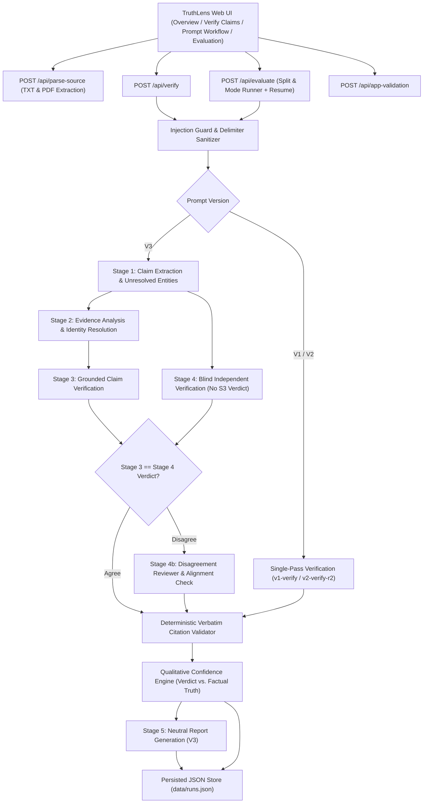

# TruthLens

**TruthLens** is an evidence-grounded, prompt-engineered fact-checking workbench built with Next.js, TypeScript, and the Google Gemini API. Rather than relying on free-form LLM answers or external web search, TruthLens evaluates claims strictly against user-supplied reference material (pasted text, `.txt` files, or `.pdf` documents) through an auditable multi-stage verification pipeline with independent blind cross-checking, verbatim citation validation, and systematic versioned prompt evaluation.

---

## Table of Contents

1. [Project Overview & Problem Statement](#project-overview--problem-statement)
2. [Project Objectives](#project-objectives)
3. [Key Features](#key-features)
4. [System Architecture](#system-architecture)
5. [Prompt Engineering Architecture (V1, V2, V3)](#prompt-engineering-architecture-v1-v2-v3)
6. [Prompt Iteration History (r0 → r1 → r2)](#prompt-iteration-history-r0--r1--r2)
7. [Technology Stack](#technology-stack)
8. [Repository Structure & Academic Evidence](#repository-structure--academic-evidence)
9. [Installation & Execution](#installation--execution)
10. [API Configuration](#api-configuration)
11. [Actual Experimental Results](#actual-experimental-results)
12. [Controlled Temperature Experiment (Stage 4)](#controlled-temperature-experiment-stage-4)
13. [Testing Methodology](#testing-methodology)
14. [Current Limitations](#current-limitations)
15. [Future Scope](#future-scope)
16. [Team Contributions](#team-contributions)

---

## Project Overview & Problem Statement

Large Language Models frequently hallucinate supporting details, conflate correlation with causation, collapse conflicting sources into binary verdicts, or treat ambiguous statements (such as unnamed titles or missing dates) as authoritative contradictions. Single-pass zero-shot prompting lacks intermediate state checks, making errors difficult to diagnose or verify.

TruthLens treats **Prompt Engineering as the primary system layer**—separating declarative JSON prompt templates from application logic, isolating untrusted user inputs with delimiter sanitization, enforcing exact verbatim citation matching, and pairing an initial grounded verifier with a **blind independent verifier** and a **conditional disagreement adjudicator**.

---

## Project Objectives

- **Evidence-Only Grounding:** Classify every extracted factual proposition strictly against supplied reference sources into `Supported`, `Contradicted`, `Insufficient Evidence`, or `Conflicting Evidence`.
- **Comparative Prompt Engineering:** Implement and benchmark three progressively structured verification architectures (`V1` zero-shot baseline, `V2` structured few-shot single-pass, and `V3` multi-stage verification with independent review).
- **Genuine Secondary Independence:** Ensure Stage 4 evaluates claims against raw reference text **without** access to Stage 3 verdicts, invoking a separate Stage 4b adjudicator only on disagreement.
- **Qualitative, Non-Inflated Confidence:** Derive verdict confidence (`High`, `Medium`, `Low`) deterministically from evidence sufficiency, verbatim citation validity, and verifier agreement—separating *verdict confidence* from *real-world factual truth confidence* when user-supplied sources are unverified.
- **Reproducible Evaluation:** Preserve archived prompt revisions (`r0`, `r1`), failure traces, benchmark splits (`development` vs. `held_out`), and CSV/JSON review exports.

---

## Key Features

- **Four-Section Workbench UI:**
  - **Overview:** Persisted run counts, verdict distribution, citation validity rate, and version snapshot (with explicit `INCOMPLETE` badges for partial runs).
  - **Verify Claims:** Input claims/statements/questions, attach multiple `.pdf`, `.txt`, or direct text sources, and compare `V1`, `V2`, and `V3` side-by-side.
  - **Prompt Workflow:** Inspect exact stage templates, temperatures, rendered user prompts, raw JSON model outputs, latency, and token consumption per run.
  - **Evaluation:** Run split-filtered (`development` / `held_out`) and mode-filtered (`atomic` / `end_to_end`) evaluations, inspect failure records, run deterministic app-validation checks, and export CSVs.
- **Prompt Injection Protection:** Regex heuristic scanner plus closing-tag neutralization (`</untrusted_claim>`, `</reference_source>`) in [`src/lib/injection-guard.ts`](src/lib/injection-guard.ts).
- **Deterministic Verbatim Citation Validator:** Verifies that every cited quote appears verbatim (whitespace-normalized) inside the referenced source ID in [`src/lib/citation-validator.ts`](src/lib/citation-validator.ts).
- **Incremental Evaluation Resume & 1-to-1 Claim Matching:** Saves completed benchmark cases incrementally and detects missing, duplicate, and unexpected extracted claims in [`src/lib/evaluator.ts`](src/lib/evaluator.ts).

---

## System Architecture



---

## Prompt Engineering Architecture (V1, V2, V3)

All prompt templates are stored externally as JSON under [`prompts/`](prompts/):

| Version | Active Template ID(s) | Temperature(s) | Design Summary |
| :--- | :--- | :--- | :--- |
| **V1 (Baseline)** | [`v1-verify`](prompts/v1/verify.json) (`r0`, unchanged) | `0.2` | Minimal zero-shot verification baseline; retained untouched for fair experimental comparison. |
| **V2 (Structured + Few-Shot)** | [`v2-verify-r2`](prompts/v2/verify.json) | `0.1` | Delimiter-isolated single-pass prompt with explicit entity/date/quantity/scope rules, ambiguity vs. contradiction rules, correlation vs. causation checks, conflict preservation, `missingInformation`/`requiredEvidence` fields, and 3 generalizable few-shot examples. |
| **V3 (Multi-Stage Pipeline)** | [`v3-stage-1-r2`](prompts/v3/01_claim_extraction.json) .. [`v3-stage-5-r2`](prompts/v3/05_report_generation.json), [`v3-stage-4b`](prompts/v3/04b_disagreement_reviewer.json) | S1: `0.0`, S2: `0.0`, S3: `0.1`, S4: `0.0`, S4b: `0.0`, S5: `0.1` | 5-stage decomposition + blind Stage 4 verification + conditional Stage 4b adjudication + neutral synthesis. |

### V3 Multi-Stage Breakdown
1. **Stage 1 (`01_claim_extraction.json`):** Decomposes compound statements into atomic propositions, normalizes questions (`did X die?`) without losing `originalSpan`, and records `unresolvedClaimEntities`.
2. **Stage 2 (`02_evidence_analysis.json`):** Extracts verbatim quotes with stances (`supports | contradicts | ambiguous`), captures `disconfirmingEvidence` and `contextualLimitations`, and outputs `identityResolution` (`resolved | partially_resolved | unresolved | contradicts_identity`).
3. **Stage 3 (`03_claim_verification.json`):** Verifies claims strictly from Stage 2 evidence, forcing `Insufficient Evidence` whenever key identities are `unresolved` or `partially_resolved`, preserving `Conflicting Evidence` when sources conflict, and outputting `missingInformation` and `requiredEvidence`.
4. **Stage 4 (`04_independent_verification.json`):** Blind independent verifier that sees raw `<reference_sources>` and claims **only** (never Stage 3 verdicts), applying a critical check for unsupported assumptions, alternative interpretations, and unresolved entities.
5. **Stage 4b (`04b_disagreement_reviewer.json`):** Conditional reviewer triggered **only** when Stage 3 and Stage 4 verdicts disagree; checks whether cited evidence genuinely supports the verdict (`evidenceSupportsVerdict`).
6. **Stage 5 (`05_report_generation.json`):** Synthesizes finalized claims without fabricating citations or describing unverified user sources as `"reliable"` or `"authoritative"`.

---

## Prompt Iteration History (r0 → r1 → r2)

Full machine-readable iteration records are preserved in [`data/prompt_iterations.json`](data/prompt_iterations.json), with complete snapshot archives in [`prompts/archive/r0/`](prompts/archive/r0/) and [`prompts/archive/r1/`](prompts/archive/r1/):

- **`r0 → r1` (`iter-r0-to-r1`):**
  - *Observed Failure:* Adversarial test `dev-06` (`"did narendar modi die"` vs. `"our pm is not dead"`) was classified as `Contradicted` by all three `r0` versions, with `V3 r0` assigning `High` confidence and calling the note `"reliable evidence"`.
  - *Refinements:* Added entity/date/scope/causation checks, question-proposition handling, Stage 5 neutrality rules, and confidence capping (`Insufficient Evidence` capped at `Medium` verdict confidence / `Low` factual truth confidence).
  - *Outcome:* `V2 r1` passed `dev-06` and scored `100%` (`7/7`) on `held_out`, but failed `e2e-02` (`C2` collapsed to `Contradicted`); `V3 r1` still failed `dev-06`.
- **`r1 → r2` (`iter-r1-to-r2`, Frozen):**
  - *Root Cause Inspection (from persisted stage traces):*
    - In `V3 r1 dev-06`, Stage 2 assumed `"our pm"` referred to Narendra Modi (`stance: "contradicts"`), which Stages 3 and 4 inherited.
    - In `V2 r1 e2e-02` (`evalId: 898f7296`), `C2` (`no serious adverse events`) stochastically collapsed to `Contradicted` despite `S1` supporting it and `S2` contradicting it.
  - *Refinements:* Added Stage 1 → Stage 2 → Stage 3 `unresolvedClaimEntities` / `identityResolution` handoff, explicit multi-source conflict rules + generalizable few-shot Example 3 in `V2`, critical perspective in Stage 4, and mandatory `missingInformation`/`requiredEvidence` fields for `Insufficient Evidence`. Also fixed corrupt PDF handling in [`src/app/api/parse-source/route.ts`](src/app/api/parse-source/route.ts) to return `HTTP 400` instead of `HTTP 500`.
  - *Outcome:* `V3 r2` achieved **100.0% (8/8 verdicts, 6/6 cases)** on `development` (with live Stage 4b rescues on `atomic-01` and `e2e-02`), and `V2 r2` achieved **100.0% (8/8 verdicts, 7/7 cases)** on `held_out`.

---

## Technology Stack

- **Framework:** Next.js 15 (`App Router`, React 19, TypeScript 5.8)
- **Styling:** Tailwind CSS v4 (dark navy / charcoal / muted teal analytical theme)
- **LLM SDK:** `@google/genai` (`^1.0.0`)
- **Document Parsing:** `pdf-parse` (`^1.1.1`) for PDF extraction + native UTF-8 `.txt` ingestion
- **Testing:** Node.js built-in test runner (`node --experimental-strip-types --test`)
- **Persistence & Exports:** Local JSON persistence (`data/runs.json`) + CSV/JSON review exports (`exports/`)

---

## Repository Structure & Academic Evidence

```text
├── prompts/
│   ├── v1/verify.json                     # Frozen V1 baseline (r0)
│   ├── v2/verify.json                     # Frozen V2 refined prompt (r2)
│   ├── v3/                                # Frozen V3 stages 1–5 + 4b (r2)
│   └── archive/
│       ├── r0/                            # Preserved r0 originals (V1, V2, V3)
│       └── r1/                            # Preserved r1 prompts (V2, V3)
├── data/
│   ├── eval_benchmark.json                # 13-case benchmark (6 dev / 7 held-out; provisional labels)
│   ├── app_validation_tests.json          # 4 deterministic input/file validation tests
│   ├── prompt_iterations.json             # Structured r0 -> r1 -> r2 iteration log
│   ├── e2e02_stage4b_trace.json           # Preserved 6-stage live trace where Stage 4b triggered
│   ├── runs.json                          # Persisted verification & evaluation run records
│   └── runs_r0_archive.json               # Preserved r0 run records
├── exports/                               # Exported CSV & JSON artifacts for academic review
│   ├── academic_review_bundle.json
│   ├── benchmark_dataset.{csv,json}
│   ├── complete_test_table.csv
│   ├── final_evaluation_metrics.{csv,json}
│   ├── prompt_iteration_history.{csv,json}
│   └── temperature_experiment.{csv,json}
└── src/
    ├── app/api/                           # verify, evaluate, prompts, runs, parse-source, app-validation, health
    ├── components/                        # Overview, VerifyClaims, PromptWorkflow, Evaluation, VerdictBadge
    └── lib/                               # pipeline, evaluator, confidence, citation-validator, injection-guard, llm, storage
```

---

## Installation & Execution

### Prerequisites
- Node.js 22+ (required for `node --experimental-strip-types` unit tests)
- npm
- A Google Gemini API key

### Setup

```bash
# 1. Install dependencies
npm install

# 2. Configure local environment variables
cp .env.example .env.local
# Edit .env.local and set GEMINI_API_KEY=<your-api-key>

# 3. Run TypeScript check, unit tests, and production build
npx tsc --noEmit
npm test
npm run build

# 4. Start the application
npm run start -- -p 3000
# Or for local development:
npm run dev
```

Open `http://localhost:3000` in your browser.

---

## API Configuration

Environment variables are configured in `.env.local` (excluded from Git via [`.gitignore`](.gitignore)). Do **not** commit `.env.local` or any real API keys; use [`.env.example`](.env.example) as a template:

| Variable | Required | Default | Description |
| :--- | :--- | :--- | :--- |
| `GEMINI_API_KEY` | Yes (for live calls) | `""` | Google Gemini API key read server-side in [`src/lib/llm.ts`](src/lib/llm.ts). |
| `GEMINI_MODEL` | No | `gemini-2.5-flash` | Target Gemini model ID. Experimental evaluations in this repository were run using `gemini-3.5-flash-lite`. |

---

## Actual Experimental Results

All factual benchmark labels are marked **`provisional`** pending manual academic review. Revisions are never mixed across metrics, and incomplete evaluations are explicitly labeled. Model used for live runs: `gemini-3.5-flash-lite`.

| Eval ID | Suite / Split | Prompt Revision | Status (Cases) | Overall Acc. (Expected) | Atomic Acc. | End-to-End Acc. | Citation Validity | Overconfidence | Failures |
| :--- | :--- | :--- | :--- | :--- | :--- | :--- | :--- | :--- | :--- |
| `a797af15` | Development | **V1 (`r0` baseline)** | Complete (`6/6`) | 87.5% | 75.0% (`4` cases) | 100.0% (`2` cases) | 100.0% | 0.0% | `1` (`dev-06` Verdict Mismatch) |
| `898f7296` | Development | **V2 (`r1`)** | Complete (`6/6`) | 87.5% | 100.0% (`4` cases) | 75.0% (`2` cases) | 100.0% | 0.0% | `1` (`e2e-02` Verdict Mismatch) |
| `c707e9ed` | Dev Retest | **V2 (`r2`)** | Targeted (`2/2`: `dev-06`, `e2e-02`) | 100.0% | 100.0% (`1` case) | 100.0% (`1` case) | 100.0% | 0.0% | `0` *(full `6/6` V2 `r2` dev run blocked by 429 quota)* |
| `f3838987` | Development | **V3 (`r2`, Stage 4 `temp=0.0`)** | Complete (`6/6`) | **100.0%** | **100.0%** (`4` cases) | **100.0%** (`2` cases) | **100.0%** | **0.0%** | `0` (`2/6` Stage 4b rescues) |
| `68bbc323` | Held-Out | **V1 (`r0` baseline)** | Complete (`7/7`) | 87.5% | 80.0% (`5` cases) | 100.0% (`2` cases) | 100.0% | 0.0% | `1` (`held-06` causal Verdict Mismatch) |
| `f7d19380` | Held-Out | **V2 (`r2`)** | Complete (`7/7`) | **100.0%** | **100.0%** (`5` cases) | **100.0%** (`2` cases) | **100.0%** | **0.0%** | `0` |
| `3a5d9881` | Held-Out | **V3 (`r2`, Stage 4 `temp=0.0`)** | **INCOMPLETE (`2/7`)** | 100.0% *(partial)* | 100.0% (`1` case) | 100.0% (`1` case) | 100.0% | 0.0% | `0` on `held-01`, `held-02`; `held-03`..`07` blocked by `429 RESOURCE_EXHAUSTED` |

### Application Validation Suite (`POST /api/app-validation`)
All `4/4` deterministic validation tests pass:
- `app-01`: Empty claim rejection (`HTTP 400`)
- `app-02`: Empty reference source rejection (`HTTP 400`)
- `app-03a`: Corrupt PDF rejection (`HTTP 400`)
- `app-03b`: Empty `.txt` upload rejection (`HTTP 400`)

---

## Controlled Temperature Experiment (Stage 4)

A controlled comparison of Stage 4 (`v3-stage-4-r2`) temperature `0.0` vs. `0.3` was executed on the identical `6`-case `development` split using `V3 r2` and `gemini-3.5-flash-lite`, holding all other stage settings and prompts constant:

| Metric | Stage 4 `temp = 0.0` (`f3838987`) | Stage 4 `temp = 0.3` (`af3a0b45`) |
| :--- | :--- | :--- |
| **Verdict Accuracy (Expected Claims)** | 100.0% (`8/8`) | 100.0% (`8/8`) |
| **Citation Validity** | 100.0% (`8/8`) | 100.0% (`8/8`) |
| **Extracted Claims Denominator** | `8` claims (`5/8` agreed, `3/8` disagreed) | `9` claims (`6/9` agreed, `3/9` disagreed) |
| **Stage 4b Activations & Effectiveness** | `2/6` cases (`atomic-01`, `e2e-02`); `3/3` claims rescued | `2/6` cases (`atomic-01`, `e2e-02`); `3/3` claims rescued |
| **Duplicate / Extra Claim Failures** | **0** | **1** (`atomic-02` split into `C1` + redundant `C2`) |
| **Average Latency / Case** | 9,222 ms | 19,332 ms |
| **Total Tokens** | 30,632 | 31,767 |

**Decision:** Stage 4 temperature **`0.0`** was selected and frozen because `0.3` added latency, token overhead, and claim-splitting redundancy (`9` extracted claims vs. `8`) without improving verdict accuracy or disagreement detection.

---

## Testing Methodology

- **Split Separation:** Benchmark cases in [`data/eval_benchmark.json`](data/eval_benchmark.json) are partitioned into `development` (`6` cases) and `held_out` (`7` cases). All prompt refinements (`r1`, `r2`) were developed using development cases only; ground-truth fields (`expectedClaims`, `notes`, `labelStatus`, `split`) are never transmitted to the LLM (enforced by unit test).
- **Mode Separation:** `atomic` single-claim evaluation is reported separately from `end_to_end` compound-claim extraction + verification (`byMode.atomic` vs. `byMode.end_to_end`).
- **Automated Unit Tests (`npm test`):** `10/10` unit tests in [`src/lib/__tests__/core.test.ts`](src/lib/__tests__/core.test.ts) cover citation validation, qualitative confidence caps, prompt injection scanning & delimiter isolation (for both claims and sources), template loading, conditional Stage 4b execution (`[SIMULATED FIXTURE]`), benchmark label isolation, 1-to-1 claim matching & duplicate/unexpected claim detection, resumed evaluation metric recomputation, and irrelevant-evidence handling (`[SIMULATED FIXTURE]`).

---

## Current Limitations

1. **Incomplete Evaluations Due to API Quota:** The `gemini-3.5-flash-lite` Free Tier daily limit (`500` requests/day `429 RESOURCE_EXHAUSTED`) blocked completion of the remaining `5/7` cases of `V3 r2 held_out` (`held-03`..`held-07`) and the full `6/6` `V2 r2 development` run. Partial results are preserved and resumable via `POST /api/evaluate` with `"resume": true`.
2. **Benchmark Coverage Gaps:** The frozen `13`-case benchmark tests prompt injection only in `claimInput` (`atomic-03`), not inside `<reference_sources>`, and omits a completely unrelated-domain irrelevant-evidence document (both behaviors are covered by simulated unit tests in `core.test.ts`).
3. **Provisional Benchmark Labels:** All `13` benchmark ground-truth labels remain `provisional` until manually reviewed.
4. **Unverified Source Credibility:** TruthLens operates offline against user-supplied materials without external web retrieval; therefore, `sourceCredibilityStatus` is always `"Unverified User-Supplied Source"`.
5. **Sequential V3 Cost & Rate-Limit Sensitivity:** Running 5–6 LLM calls per claim makes `V3` significantly slower and higher-token than `V2` and sensitive to Free Tier RPM/RPD limits.

---

## Future Scope

- Complete the resumed `V3 r2 held_out` (`5` remaining cases) and full `V2 r2 development` (`6` cases) evaluations once API quota resets.
- Conduct human expert review to promote `eval_benchmark.json` labels from `provisional` to `reviewed`, and expand the held-out suite with `<reference_source>`-embedded injection and completely off-topic irrelevant-evidence cases.
- Evaluate stronger / higher-throughput models under identical frozen prompts and Stage 4 settings.
- Add optional source-provenance metadata scoring (kept strictly separated from verbatim quote validity).

---

## Team Contributions

*Project team member names and individual task allocations are left blank for accurate completion by the authors prior to submission.*

| Team Member | Role | Assigned Contributions |
| :--- | :--- | :--- |
| `[Member 1 — Name / ID]` | `[Role]` | `[Verified contributions]` |
| `[Member 2 — Name / ID]` | `[Role]` | `[Verified contributions]` |
| `[Member 3 — Name / ID]` | `[Role]` | `[Verified contributions]` |
